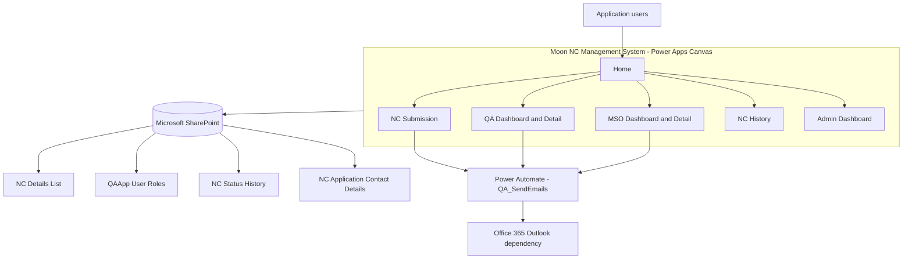

# Moon NC Management System

### Non-Conformance Management & Quality Compliance | Microsoft Power Platform

Moon NC Management System is a Microsoft Power Apps Canvas application designed to centralize the submission, review, tracking and closure of Non-Conformance (NC) records. It provides dedicated experiences for NC submitters, Quality Assurance (QA), MSO and administrators, with audit-oriented dashboards, status history, repeat tracking and email notifications.

The application brings NC intake, corrective-action follow-up, operational visibility and user administration into a single workspace.

---

## 01. Project Overview

| Item | Details |
|---|---|
| Application name | Moon NC Management System |
| Application type | Microsoft Power Apps Canvas App |
| Business domain | Quality Assurance, Audit & Compliance, Non-Conformance Management |
| Primary purpose | Capture, monitor, review and close non-conformance records across audit categories and operational towers |
| Intended users | NC submitters/requestors, QA users, MSO users and administrators |
| Interface | Desktop/tablet, landscape |
| Canvas dimensions | 1366 × 768 |
| Data platform | Microsoft SharePoint |
| Automation | Power Automate email flow |
| Project status | Developed application; production deployment status is not established by the supplied files |

### What the application does

Moon NC Management System provides a common workspace to:

- Submit new NC records with audit, application, tower, requestor and checkpoint information.
- Review NCs through dedicated QA and MSO dashboards.
- Monitor audit/SLA counts by powerhouse and audit type.
- Update NC status and record corrective-action remarks.
- Maintain a chronological status history.
- Track reopened and repeated NCs.
- Review closed NC records through history views.
- Administer application users and role assignments.

### Application modules

| Module | Purpose |
|---|---|
| Home | Entry point to NC submission, QA dashboard and MSO dashboard |
| New NC Submit | Captures a new non-conformance record |
| QA Dashboard | Provides QA-oriented audit/SLA visibility and NC review |
| MSO Dashboard | Provides MSO-oriented audit/SLA visibility and NC review |
| NC Detail | Displays record information and supports role-based updates |
| NC History | Provides historical NC records and filtering |
| Admin Dashboard | Supports active NC administration and user/role management |

---

## 02. Business Problem & Objective

### Business problem

Non-conformance management involves more than recording an issue. Each NC needs to be associated with its operational context, reviewed by the appropriate teams, updated with corrective-action information and followed through to closure. Teams also need visibility into outstanding records, repeated issues and status changes.

When this information is spread across separate trackers, emails and manual follow-ups, it becomes harder to maintain a consistent view of issue ownership, review progress, action history and closure status.

The application is designed to provide a structured, centralized way to manage this lifecycle.

### Previous/manual process

The supplied application package and screenshot document do not describe a formal before-state process or quantify the time spent on manual activities. The operational challenges below therefore describe the problem the application is designed to address, rather than measured claims about a previous process:

- NC information needs to be captured consistently across audit categories and operational towers.
- QA and MSO users need a shared view of records requiring their attention.
- Status changes and remarks need to remain traceable.
- Reopened and repeated NCs need to be identifiable.
- Historical records need to be searchable for review and follow-up.
- Administrators need a controlled way to maintain application users and roles.
- Relevant users need notifications when NC events or updates occur.

### Why an application was needed

A centralized Canvas App provides a common interface for capturing NC details, viewing role-oriented work queues, updating records and monitoring progress. Connecting the application to SharePoint provides persistent record storage, while the notification flow supports email communication for key NC events.

### Application objectives

1. Standardize the capture of new NC records.
2. Provide QA and MSO teams with dedicated review dashboards.
3. Make audit/SLA distribution visible by powerhouse and audit type.
4. Support structured status updates and corrective-action remarks.
5. Maintain a history of NC status transitions.
6. Identify reopened and repeated NCs.
7. Provide historical filtering and review capabilities.
8. Enable administrators to manage application users and role assignments.
9. Trigger email notifications for configured NC events and updates.

---

## 03. Key Features & Functionality

### 3.1 New NC submission

The NC submission experience captures the information required to register a non-conformance.

Visible form fields include:

- Tower
- Audit Name
- Applications
- MSO Name
- NC Requestor
- Checkpoints
- Status
- Document Name
- Current Cycle
- Remarks

Fields marked as required in the interface are configured as mandatory form inputs. On successful form submission, the app generates an NC reference using the submitted SharePoint item ID and updates the record with an initial agent status.

### 3.2 QA dashboard

The QA dashboard provides a consolidated view of NCs and audit/SLA distribution.

Capabilities evidenced in the application include:

- Audit/SLA matrix grouped by powerhouse and audit type.
- NC records presented in a selectable list.
- Detailed NC information for the selected record.
- QA status update form.
- QA remarks and action history.
- NC closure and reopening handling.
- Status-history recording.

### 3.3 MSO dashboard

The MSO dashboard provides an equivalent operational view for MSO review activities.

Capabilities include:

- Audit/SLA distribution view.
- NC list and selected-record details.
- MSO action/status information.
- MSO remarks.
- Update interaction and notification trigger.
- Visibility into the action history associated with the NC.

### 3.4 Audit and SLA monitoring

The dashboard matrix organizes counts by:

- **Powerhouse:** PH1, PH2, PH3, PH4 and PH5.
- **Audit type:** AT1, AT2, AT3, AT4, AT5, AT6 and AT7.

The matrix gives users a quick view of where NC records are distributed across the available powerhouse and audit-type combinations.

### 3.5 NC detail and action tracking

The detail experience separates the record into distinct information areas:

- **NC List:** records available for selection.
- **NC Details:** source information such as tower, audit name, application, document, requestor, frequency and checkpoint information.
- **Action taken by MSO:** MSO status and remarks.
- **Action taken by QA:** QA remarks and status-related information.
- **Action taken by Agent:** agent status and report information, where available.
- **NC Update:** status, remarks and reopen interaction.

This layout gives reviewers the context of the original issue alongside the actions recorded by the different participants.

### 3.6 Status history

The application uses the `NCStatusHistory` SharePoint data source to maintain status-transition information.

The status history experience includes:

- NC reference.
- Previous status.
- New status.
- User who made the change.
- Date/time of the change.

The NC History screen also provides filters such as Tower, Audit and repeat-only selection, together with a reset action.

### 3.7 Reopen and repeat tracking

The NC detail interface includes a reopen control and confirmation interaction. The application also displays repeat-related information, including repeat count and a repeat indicator in the historical/admin views.

The QA update logic includes handling for an NC moving to the closed state and for a confirmed reopen event.

### 3.8 Email notifications

The app invokes the Power Automate flow `QA_SendEmails` for configured events. Flow event labels visible in the Canvas App source include:

- `New_NC`
- `MSO_Updated`
- `QA_Updated`
- `QA_Updated_Closed`
- `NC_Reopened`

The app passes the event identifier, NC item ID and current user's email to the flow. The complete flow definition, recipient rules and email templates are not included in the supplied `.msapp` package and should be reviewed separately before documenting their exact behaviour.

### 3.9 Admin dashboard and user management

The administrator experience provides two main areas:

**Manage Active NCs**
- View active NC records.
- Filter by Tower, Audit and Status.
- Apply a repeat-only filter.
- Review record details and repeat indicators.
- Access record-level edit actions.

**Manage Users**
- View configured application users.
- Search by user name/email.
- Filter by role.
- Add a user.
- Assign a role.
- Edit or delete a user entry.

The role options visible in the app include `Admin`, `QA` and `MSO`.

### 3.10 User roles and permissions

The application resolves the signed-in user's role from the `QAApp_UserRoles` data source during app initialization. The source includes an authorization check that displays an error and exits when no role is found.

| Role | Application experience evidenced |
|---|---|
| Admin | Admin dashboard, active NC administration and user management |
| QA | QA dashboard and QA NC review/update experience |
| MSO | MSO dashboard and MSO NC review/update experience |
| NC submitter/requestor | New NC submission experience; exact role mapping should be confirmed in the deployed configuration |

The source establishes role lookup and role-aware application behaviour. The complete permission matrix and backend data-source permissions are not established by the supplied files. UI visibility alone should not be treated as a security boundary.

---

## 04. Screenshots & User Interface

The supplied `APNC.docx` contains eight pages of application screenshots. The following gallery map follows the source document's page order. Export the screenshots as individual image files into the repository's `Screenshots/` folder and update the image paths below to match the exported filenames.

| Screenshot / screen | What it demonstrates | Source |
|---|---|---|
| Home screen | Three entry points: New NC Submit, QA Dashboard and MSO Dashboard | Page 1, upper image |
| NC Detail Form | New NC submission fields and Submit/Back actions | Page 1, lower image |
| QA Dashboard | Audit/SLA matrix across PH1–PH5 and AT1–AT7 | Page 2, upper image |
| QA NC Detail | NC list, detailed record information, MSO action area and QA update panel | Pages 2–6 |
| Status history panel | Status transition information for the selected NC | Page 7, upper image |
| MSO Dashboard | MSO audit/SLA matrix | Page 7, lower image |
| NC History | Tower/Audit filters, repeat-only toggle and historical NC table | Page 8, upper image |
| Admin – Active NCs | Active NC listing with filters and record actions | Page 8, middle image |
| Admin – Add User | User creation dialog with role and username fields | Page 8, lower image |
| Admin – Manage Users | User list with role, edit and delete actions | Page 8, lower image |

### Suggested screenshot gallery

Create a `Screenshots/` directory and export/crop the relevant screenshots from the Word document. Suggested filenames:

```text
Screenshots/
├── 01-home-dashboard.png
├── 02-new-nc-form.png
├── 03-qa-dashboard.png
├── 04-qa-nc-detail.png
├── 05-nc-status-history.png
├── 06-mso-dashboard.png
├── 07-nc-history.png
├── 08-admin-active-ncs.png
└── 09-admin-user-management.png
```

After adding the images, use Markdown image links such as:

```markdown

```

### UI design observations

- Purple is used as the primary accent colour for headers, buttons and section headings.
- A light background keeps the dashboard and form areas visually separated.
- The home screen uses three prominent navigation cards for the main user journeys.
- QA and MSO detail experiences use a three-part layout for the NC list, record details and update actions.
- Audit/SLA information is presented as a matrix with colour intensity differentiating counts.
- Confirmation dialogs are used for sensitive actions such as reopening an NC.
- A shared header component provides a consistent title and signed-in user area.

> **Portfolio publishing note:** Review every screenshot before making the repository public. Remove or blur real names, email addresses, tenant information, internal identifiers, company branding and any confidential operational data. The supplied screenshots contain sample-looking user details and organizational references that should be checked rather than assumed to be fictitious.

---

## 05. Technical Architecture

### Technology stack

| Layer | Technology / component | Evidence |
|---|---|---|
| Presentation | Microsoft Power Apps Canvas App | Confirmed in `.msapp` package |
| Application logic | Power Fx | Confirmed in screen and app source |
| Data layer | Microsoft SharePoint lists | Connected data-source definitions |
| Workflow integration | Power Automate | `QA_SendEmails` flow connection |
| Email integration | Office 365 Outlook | Declared as a dependency of the flow connection |
| Reusable UI | Canvas Components | Component definitions in the app package |

### High-level architecture



> This is a logical architecture reconstructed from the Canvas App package. It is not a verified infrastructure diagram. The actual SharePoint site, list permissions, flow triggers/actions, recipient configuration and environment-specific connection references should be confirmed in the target Power Platform environment.

### Data sources identified in the app package

| Data source | Apparent purpose based on its name and app usage |
|---|---|
| `NC Details List` | Main NC records, submission information, status and action-related fields |
| `QAApp_UserRoles` | User identity and application role lookup |
| `NCStatusHistory` | NC status transition log, including old/new status, changed-by user and timestamp |
| `NCApplicationContactDetails` | Application/contact reference information; exact usage should be validated against the deployed list |
| `QA_SendEmails` | Power Automate flow connection used for NC email events |

The four SharePoint lists are declared as connected data sources in the `.msapp` package. `QA_SendEmails` is declared as a flow/service connection.

### Integration flow

The Canvas App calls `QA_SendEmails.Run(...)` with an event label, an NC record ID and the current user's email address. The event labels in the app source indicate that the flow is used for new NC submissions, MSO updates, QA updates, QA closure updates and NC reopening.

The app package identifies an Office 365 Outlook dependency for the flow connection. The flow's internal actions and email design are not embedded in the Canvas App source.

### Environment and connection considerations

- The app is connected to environment-specific SharePoint data sources.
- Connection references must be rebound when importing into another environment.
- The SharePoint lists and required columns must exist before the app can operate correctly.
- The Power Automate flow must be available and its connections configured.
- Users need appropriate permissions to the app, lists and flow-connected resources.
- Tenant/site URLs and internal connection identifiers should not be published in a public repository.

---

## 06. Technical Implementation

### 6.1 Application initialization and role validation

The app's `App.OnStart` formula reads the signed-in user's email, looks up the corresponding role in `QAApp_UserRoles`, checks whether the user is authorized and initializes the administrator flag and primary colour.

Representative source formula:

```powerfx
// Current user email
Set(
    varCurrentUserEmail,
    User().Email
);

// Direct role lookup
Set(
    varUserRole,
    LookUp(
        QAApp_UserRoles,
        UserName.Email = varCurrentUserEmail,
        Role.Value
    )
);

// Authorization check
If(
    IsBlank(varUserRole),
    Notify(
        "You are not authorized to access this app.",
        NotificationType.Error
    );
    Exit()
);

// Admin flag
Set(
    varIsAdmin,
    varUserRole = "Admin"
);

Set(varPrimaryColour, RGBA(117, 0, 192, 1));
```

### 6.2 NC reference generation and submission

The new NC form uses a successful-submit handler to retrieve the saved SharePoint item, generate a reference using its ID, update the record and add an initial entry to the status-history list.

Representative formula from the form's `OnSuccess` logic:

```powerfx
Set(
    varLastItem,
    'NC Detail Form'.LastSubmit
);

// Generate the Request ID
Set(
    varRequestID,
    "NC-" & varLastItem.ID
);

// Update the submitted record
Patch(
    'NC Details List',
    varLastItem,
    {
        Title: varRequestID,
        'Agent Status': { Value: "Pending Agent Review" }
    }
);

// Record the initial status history
Patch(
    NCStatusHistory,
    Defaults(NCStatusHistory),
    {
        Title: varRequestID,
        OldStatus: "New NC - Submitted",
        NewStatus: varSelectedStatus,
        ChangedOn: Now()
    }
);

Notify(
    "NC Details Submitted successfully",
    NotificationType.Success
);

Navigate(HomeScreen);
```

The source also invokes the notification flow after submission:

```powerfx
QA_SendEmails.Run(
    "New_NC",
    'NC Detail Form'.LastSubmit.ID,
    User().Email
);
```

### 6.3 Status transition history

The QA and MSO update experiences compare the previous status with the selected status. When a status changes, the app creates a record in `NCStatusHistory`.

Representative pattern:

```powerfx
If(
    varOldStatus <> DataCardValue15.Selected.Value,
    Patch(
        NCStatusHistory,
        Defaults(NCStatusHistory),
        {
            Title: QAUpdateForm.LastSubmit.Title,
            OldStatus: varOldStatus,
            NewStatus: DataCardValue15.Selected.Value,
            ChangedOn: Now()
        }
    )
);
```

The full source also captures the user who made the change using a SharePoint expanded-user record. The exact field/control names differ between the QA and MSO update forms.

### 6.4 QA closure and reopen handling

The QA update success logic includes a closure-date update when the selected status changes to `NC Closed`. It also calls the email flow with different event labels depending on whether the NC was closed, reopened or normally updated.

```powerfx
If(
    DataCardValue15.Selected.Value = "NC Closed" &&
    varOldStatus <> "NC Closed",
    Patch(
        'NC Details List',
        QAUpdateForm.LastSubmit,
        {
            'NC Closed Date': Today()
        }
    )
);
```

The notification branch in the source uses event labels including `QA_Updated_Closed`, `NC_Reopened` and `QA_Updated`.

### 6.5 Power Fx implementation patterns

| Power Fx function | How it is used in the application |
|---|---|
| `Set()` | Stores signed-in user, role, selected NC, selected dashboard, status and UI state |
| `ClearCollect()` | Builds local checkpoint, audit-document and NC working collections |
| `Filter()` | Filters NC records and dashboard/history views |
| `LookUp()` | Resolves user roles and selected record information |
| `Patch()` | Updates NC records and creates status-history records |
| `SubmitForm()` | Submits form-based NC and update records |
| `Refresh()` | Refreshes connected data after operations |
| `CountRows()` | Calculates dashboard and gallery counts |
| `SortByColumns()` | Sorts records for display |
| `Distinct()` | Creates unique filter values |
| `ForAll()` | Performs iterative record operations where required |
| `If()` | Implements conditional status and UI behaviour |
| `Notify()` | Displays success and error feedback |
| `Navigate()` | Moves users between app screens |
| `ResetForm()` / `Reset()` | Resets form and filter controls |

### 6.6 Collections and variables

Collections identified in the app source include:

| Collection | Purpose indicated by the source |
|---|---|
| `colCheckpoints` | Stores audit-type checkpoint reference values |
| `colAuditDocuments` | Stores audit-specific document reference values |
| `colNCDetails` | Local NC detail working collection |
| `colQADetails` | QA-oriented NC detail collection |
| `colMSODetails` | MSO-oriented NC detail collection |
| `colAuditCycle` | Audit-cycle reference/working data |

Important variables identified in the source include:

| Variable | Purpose |
|---|---|
| `varCurrentUserEmail` | Signed-in user's email |
| `varUserRole` | Resolved application role |
| `varIsAdmin` | Administrator flag |
| `varPrimaryColour` | Primary UI colour |
| `varSelectedDashboard` | Selected dashboard context |
| `varSelectedNC` | Selected NC record |
| `varSelectedNCID` | Selected NC record identifier |
| `varSelectedAuditType` | Selected audit type |
| `varSelectedAuditName` | Selected audit name |
| `varSelectedPowerhouse` | Selected powerhouse |
| `varSelectedStatus` | Selected status |
| `varRequestID` | Generated NC reference |
| `varOldStatus` | Previous NC status |
| `varRepeatConfirmed` | Reopen/repeat confirmation state |
| `varShowStatusHistory` | Status-history panel visibility |
| `varShowPopup` | Popup visibility state |
| `varActiveTab` | Selected administrator tab |

### 6.7 Reusable components

The `.msapp` package contains multiple Canvas Component definitions for shared header experiences. The screens reuse a header component to provide a consistent title, logo area and signed-in user context.

Reusable components help maintain a consistent visual structure across the home, dashboard, detail, history and admin screens.

### 6.8 Forms and validation

- The NC submission form is built using Power Apps form and data-card controls.
- Required fields are indicated in the interface.
- Dropdown/combobox controls use SharePoint choice values for fields such as Tower, Audit Name, MSO Name, NC Requestor and status-related selections.
- Successful form submission is handled through the form's `OnSuccess` event.
- The app uses confirmation interactions for reopening-related actions.

The complete validation matrix and all failure scenarios should be checked in Power Apps Studio before being documented as exhaustive.

### 6.9 Delegation considerations

The app uses SharePoint-connected data sources with filtering, lookups, sorting and count calculations. The package sets `DefaultConnectedDataSourceMaxGetRowsCount` to `2000`.

For larger production datasets, validate:

1. Whether each SharePoint query is delegable.
2. Whether dashboard counts are calculated over the intended full dataset.
3. Whether local collections contain all records required by the user journey.
4. Whether list columns used in filters should be indexed.
5. Whether repeated refreshes and lookups can be reduced.
6. Whether large galleries need server-side filtering or paging patterns.

The configured 2,000-row setting does not prove that every query retrieves all records or that every formula is delegation-safe.

### 6.10 Error handling and performance

The source includes user-facing `Notify()` messages, form success handlers, authorization checks and data refresh patterns.

Areas to validate further in the target environment include:

- Form submission failures and field-level validation.
- SharePoint permission or connectivity errors.
- Power Automate flow failures and timeout behaviour.
- Handling of stale data after an NC update.
- Collection refresh strategy after create/update operations.
- Delegation warnings on large NC lists.
- Role enforcement at the SharePoint and flow layers.

---

## 07. My Contribution

This section is a portfolio-ready draft based on the implementation visible in the supplied app package. Adjust the wording to reflect the work personally completed.

### Application design and development

- Designed and developed a multi-screen Power Apps Canvas application for Non-Conformance management.
- Built the NC submission form and its record-creation logic.
- Developed separate QA and MSO dashboard experiences.
- Implemented the audit/SLA matrix across powerhouse and audit-type dimensions.
- Built NC list, detail and update experiences for operational review.
- Implemented status-history tracking using a dedicated SharePoint list.
- Developed NC History filtering and repeat-only review interactions.
- Built an administrator workspace for active NC review and user-role management.
- Implemented role lookup and authorization checks using the signed-in user's identity.
- Integrated the app with SharePoint data sources and the `QA_SendEmails` Power Automate flow.
- Used reusable Canvas Components and a consistent purple-themed UI.

### Technical challenges and design decisions

| Challenge / requirement | Implementation approach |
|---|---|
| Different teams need different workspaces | Created separate QA and MSO dashboard/detail experiences |
| NC records need traceable references | Generated an NC reference from the saved SharePoint item ID |
| Status changes need an audit trail | Added status-history records when the status changes |
| Reviewers need the original issue and action context together | Designed a structured NC detail layout with separate action areas |
| Reopened and repeated NCs need visibility | Added reopen confirmation and repeat-related indicators/counts |
| Access needs to reflect application roles | Resolved the signed-in user's role from the user-role list |
| Users need timely updates | Integrated configured NC events with a Power Automate email flow |
| Users need to review older records | Created a dedicated history screen with filters |

### Important design decisions

- Kept NC submission separate from QA/MSO review to distinguish intake from subsequent action.
- Used role-oriented dashboards to make each team's work queue easier to navigate.
- Stored status transitions separately from the main NC record to preserve a chronological history.
- Used SharePoint as the connected record store and Power Automate for notification integration.
- Used a common header component to keep screen navigation and branding consistent.

---

## 08. Project Files & Resources

### Recommended GitHub repository structure

```text
Moon-NC-Management-System/
│
├── README.md
│
├── App/
│   └── NCApplication.msapp
│
├── Screenshots/
│   ├── 01-home-dashboard.png
│   ├── 02-new-nc-form.png
│   ├── 03-qa-dashboard.png
│   ├── 04-qa-nc-detail.png
│   ├── 05-nc-status-history.png
│   ├── 06-mso-dashboard.png
│   ├── 07-nc-history.png
│   ├── 08-admin-active-ncs.png
│   └── 09-admin-user-management.png
│
├── Documentation/
│   ├── APNC.docx
│   └── Technical-Notes.md
│
└── Architecture/
    └── NC-Application-Architecture.md
```

### Project resources

| Resource | Description |
|---|---|
| `NCApplication.msapp` | Original Power Apps Canvas App package |
| `APNC.docx` | Eight-page screenshot/reference document supplied for the application |
| `Screenshots/` | Recommended location for individually exported and sanitized application screenshots |
| `Documentation/` | Supporting functional and technical notes |
| `Architecture/` | Logical architecture diagram and integration notes |

### Import and configuration notes

To run or maintain the application in another Power Platform environment:

1. Import the `.msapp` file into Power Apps Studio.
2. Reconnect the four SharePoint data sources.
3. Confirm the required SharePoint lists and columns exist.
4. Configure the `QA_SendEmails` Power Automate flow connection.
5. Rebind the flow's Office 365 Outlook connection as required.
6. Populate the user-role list with authorized users and supported roles.
7. Verify SharePoint permissions and flow permissions.
8. Test NC submission, status updates, history creation, reopening and email notifications.
9. Validate the app in the target environment before publishing.

> The `.msapp` package contains app definitions and connection references, not a self-contained copy of the SharePoint lists or the complete Power Automate flow. Those dependencies must be configured separately.

---

## Important Notes

- This repository is intended as a Power Apps portfolio presentation of the application.
- Screenshots should be sanitized before public release.
- Environment-specific tenant URLs, connection IDs, real user information and confidential business data should not be committed.
- The exact Power Automate flow implementation and deployed security configuration are outside the supplied app package.
- The README describes capabilities supported by the supplied `.msapp` source and screenshot document; deployment and production status should be confirmed separately.

---

### Built with

**Microsoft Power Apps · Power Fx · SharePoint · Power Automate · Office 365 Outlook**

